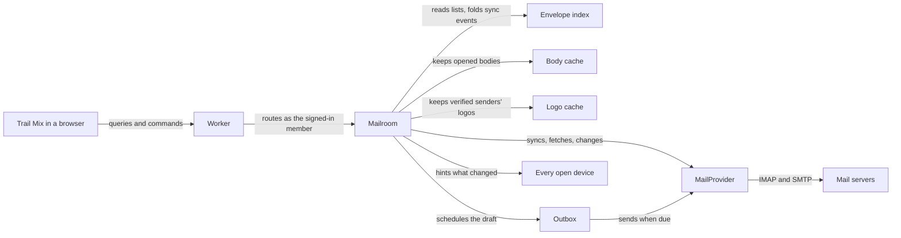

# Trail Mix

Trail Mix is an open-source, keyboard-first mail client that you host yourself. A TanStack Start single-page app, styled with Astryx and StyleX, runs as one Cloudflare Worker. That one deployment serves its operator and the people they invite, and each of them gets a private Mailroom for their own IMAP accounts. It is dense, quiet and fast, and as good on a phone as on a desktop.

This file is the working agreement for everyone who changes this repository, human or agent. A change is reviewed against the rules below. When a change needs a concept, a guarantee or a folder that this file does not name, stop and get this file amended first. Do not invent it in code.

## How it fits together

Every request goes through the Worker to the Mailroom of the signed-in member, and only the Mailroom talks to mail servers.



- **Operator and members.** The operator deploys Trail Mix, pays for it and invites people. A member is anyone invited. Sign-in belongs to Cloudflare Access, which emails a one-time code, so Trail Mix holds no password and has no sign-in code of its own.
- **Worker.** Serves the app, verifies the Cloudflare Access identity on every request, and routes to the Mailroom of that member. Each of the app's responses carries a Server-Timing header, so a member's browser shows where a request's time went: `access` for sign-in, `mailroom` for the wait on the Mailroom with the call's name, `reached`, `ran` and `returned` for how much of that was reaching it, running there and coming back, which counts an answer Cloudflare holds until the Mailroom's writes are stored, `worker` for the whole request, and `isolate` or `cold` when the Worker or the Mailroom started for it. It holds names and times only. On Cloudflare a clock stands still while code runs, so each time counts waiting, not computing. A call that reached the Mailroom and failed in a way Cloudflare marks `retryable`, and not `overloaded`, as when a deploy restarts it mid-call, is asked again through a new stub, twice at most within about a second, for queries and for the commands a second run leaves as the first did. When the page still can't reach its Mailroom, it says what failed, the status and the reason, and asks again by itself once the tab is seen again or the network returns.
- **Mailroom.** One Durable Object per member, created on first sign-in, with private storage. It is the only writer of anything Trail Mix stores for that member and the only thing that opens a mail connection.
- **Envelope index.** SQLite inside the Mailroom, with a full-text table over senders, recipients, subjects and previews. Lists, conversations and search read it. A search lists conversations newest first by the newest message that matches, and each row shows that message. A search as it is typed lists at most its newest 1,000 conversations, found by reading its matches newest first and stopping there, so a first letter costs no more than a word, and it says so when it reaches them.
- **Body cache.** Raw messages in object storage, keyed by `MessageRef`. A body is fetched from the mail server the first time it is opened and kept after that.
- **Logo cache.** The BIMI logos of the domains that send the member verified mail, kept in the Mailroom per domain. Verified mail from a domain owes it a lookup, at most once a week, and a logo held is looked up again each week, a few domains each wake. The demo mailbox brings its own logos and looks nothing up.
- **Outbox.** A schedule of drafts to send, driven by the Mailroom's alarm. Undo send and send later are the same mechanism, and every send can be undone for ten seconds. It records that the host accepted a message before filing it, so a retry after a failure or a restart only files. On a host that files its own copy in Sent, as Zoho and Outlook do, the Outbox looks for that copy for up to two minutes after acceptance, and files one itself only if none has come, so the host's setting and its delay never leave two copies or none. A send that fails for a passing reason, such as no connection or an SMTP 4xx, retries after 1, 2, 4, 8, 16 and 32 minutes and then hourly, until its retries have waited a day. A refusal, or a connection lost after the message went out, waits for Retry, and so does a send a restart cut short before its acceptance was recorded, which says it may have gone.
- **Notifications.** A device a member turns notifications on for subscribes with the deployment's push key, which the deploy makes once as `PUSH_KEY`, and the Mailroom keeps its subscription. Once a wake's sync is done, the Mailroom tells those devices by Web Push of the news it folded into an Inbox: mail the server reports unseen, newer than the Inbox's mark, dated within a day, and not moved there by the member, as an undone archive is. A sync that starts an Inbox over, as a first sync does, tells nothing. Each conversation gets one notification, which a newer one replaces, and more than three at once become one summary. While any device is notified, mail is checked every four minutes rather than five, so news reaches it within five. A push service that says a subscription has ended forgets the device. Previews and the demo have no push key, so they notify nobody. Only the installed app subscribes, from the bell at the foot of the sidebar or its palette command, which ask the browser's leave from the tap itself. What turning them on and off does stays off the first screen, and loads as soon as the bell can show, so it is in hand by any tap. In a browser's tab the bell says to install Trail Mix first, and on an iPhone to add it to the Home Screen. A push is a Declarative Web Push message, which Safari shows with no script and opens on a tap. Elsewhere the service worker shows it, with Archive and Mark read where the platform shows a notification's buttons. A button posts to `/notifications/act`, and one whose sign-in has lapsed opens the conversation instead. A tap opens the conversation in the open Trail Mix, or in a new window.
- **MailProvider.** The one contract every mail host is reached through. It has two implementations: IMAP with SMTP, of which Zoho and Outlook are presets, and a seeded demo mailbox that tests, agents, previews and the public demo all use.
- **Browser.** TanStack Query holds snapshots and applies changes optimistically. Each tab holds one WebSocket to its Mailroom.

Three routes cover the whole system:

- **Reading.** Lists come from the index, with verified senders' logos from the Logo cache. A body comes from the mail server once and from the cache after that.
- **Sending.** Send schedules a saved draft, and the Outbox submits it when the undo window closes.
- **Staying current.** The Mailroom syncs, folds what changed into the index, and hints every open device to refetch. Inbox is watched live while a device has Trail Mix open and checked every few minutes otherwise. A deploy or an eviction can drop the held connection at any time, so every wake is a cold start: reconnect, sync from the stored cursor, resume watching.

The mail server stays the only authority for mail. Trail Mix owns four things: account settings, encrypted credentials, the schedule of messages waiting in the Outbox, and the devices each member asked to be notified on.

### Vocabulary

Every layer uses the same nouns, with the same names in the index, the contracts and the interface. `src/features/mail/core/model.ts` defines them.

| Noun         | Meaning                                                                                                                                |
| ------------ | -------------------------------------------------------------------------------------------------------------------------------------- |
| Account      | One mailbox a member has connected: a name, a stamp color, an optional From name and signature, its light paper senders, and a status. |
| Folder       | A folder on the mail server, named by a `FolderRef` (account and path), with an optional role, its counts, and its server's delimiter. |
| Folder role  | `inbox`, `sent`, `drafts`, `archive`, `trash` or `junk`. Folders are recognized by role, never by name.                                |
| Message      | What the index holds for one message: its `Envelope` and the conversation it belongs to.                                               |
| `MessageRef` | A message's identity, which is the mail server's own: account, folder path, UIDVALIDITY and UID.                                       |
| Envelope     | What a provider reports about a message: everything a list or a search needs, whether its sender is verified, and no body.             |
| Verified     | A message whose own server's topmost Authentication-Results, under the name the account's preset gives, says DMARC passed for From.    |
| Logo         | A verified sender's brand logo, named by its From domain, which a message or a row names only while the Logo cache holds it.           |
| Conversation | The messages of one account that reply to each other, gathered from its Inbox, Sent, Archive and Drafts.                               |
| Body         | The content of one message, fetched on first open. It never changes for a `MessageRef`.                                                |
| Draft        | A message in a folder whose role is `drafts`. It lives on the mail server, not in Trail Mix.                                           |
| Outgoing     | An Outbox entry: a draft, when to send it, and how the attempt is going.                                                               |
| View         | What a list shows: one folder, a unified Inbox, Flagged, Drafts or Outbox across every account, or a search.                           |
| Place        | Where a member is: a view and the conversation open in it, which the address names, so a reload or a link opens the same place.        |
| Hint         | A message on the WebSocket that names what changed, so the browser knows what to refetch.                                              |
| Stamp        | An account's color. In a list that mixes accounts it lies on the corner of each row's avatar, and it marks the composer's From chip.   |

### Contracts

Every feature is built against three contracts. Change one only together with this file.

- **The mail vocabulary**, in `src/features/mail/core`. It is the one set of types every layer shares.
- **MailProvider**, in `src/features/providers/provider.ts`. Adding a protocol means implementing this interface and nothing else. `sync` reports events (`message`, `flags`, `gone`, `reset`) since a cursor, one bounded batch at a time and newest first, and the index is the fold of those events. A folder starting over begins with a batch of at most 100, so its newest mail shows soon. The fold returns the rows to write, and the Mailroom writes nothing else. The cursor belongs to the provider and is opaque to the Mailroom. `search` asks the server across a whole folder and resolves with envelopes, newest first and at most 100. A full-text result outside the index opens like any other and is never written to the index. `watch` is best effort, so the Mailroom still polls. `deleteFolder` takes the folders inside with it, deepest first, and resolves only once the server no longer lists them.
- **What a browser can ask its Mailroom**, in `src/features/mailroom/client`. Typed server functions carry queries and commands, one WebSocket carries hints, plain GET routes carry the bytes of messages, remote images and logos, and one POST route, `/notifications/act`, carries a notification's Archive and Mark read. Web Push carries notifications to the devices a member turned them on for, open or not. There is no other channel. Queries return snapshots. A list comes a page of 50 at a time, from any place in it, and every page says how long the whole list is. Commands return once the Mailroom has accepted them. `addAccount` is the only call that carries a secret, and it keeps nothing until the IMAP and SMTP hosts both take it. A refusal reads in the host's own words, or names the host and port it couldn't reach. Archive and delete are moves to a folder role. A folder is created at its parent's path, delimiter and name, renamed only within its parent, and never renamed or deleted when it, or a folder inside it, has a role. `folders/core/problems.ts` holds the name rules, which the browser checks before it asks and the Mailroom checks again. A folder change shows in the browser at once, laid over the folders until a snapshot shows it, and is lifted with the server's reason if refused. A row names the logo of its newest sender other than the member, and a message names its own, and a `logos` hint has every device refetch the lists on screen when a logo comes or goes.

## Architecture rules

These are invariants. Breaking one needs an amendment to this file, not a clever exception.

- **One authority.** The mail server is the truth for mail. The index, the body cache and the Logo cache are disposable: deleting them loses nothing, and they rebuild from the server and the senders' DNS.
- **The server's identity.** A message is its account, folder path, UIDVALIDITY and UID. Trail Mix mints no message ids of its own.
- **One write path into the index.** Only folded sync events change it. A command changes the mail server, the next sync reports the change, and the fold records it. Browsers show the change optimistically in the meantime.
- **Safe to repeat.** Every write is idempotent. Folding an event again, replaying a sync batch after a cold start, retrying a command and refetching on a duplicate hint change nothing the first time did not, so the recovery from any failure is to try again.
- **A pure core.** Conversation linking, the index fold, IMAP sync reconciliation, quote detection, Markdown-to-mail rendering and the Outbox state machine are pure functions. A `core` module never reaches React, Astryx, StyleX, Cloudflare or a mail library, directly or through another module.
- **Providers per protocol, presets per vendor.** Zoho and Outlook are presets of the one IMAP and SMTP provider: hosts, ports, sign-in method, the names its receiving servers sign Authentication-Results with, and quirks such as whether the server files its own copy in Sent. An account trusts the signing names of the preset whose hosts share its IMAP host's domain, so Zoho's names reach an account on Zoho's hosts whatever it was set up with, and a server no preset names verifies nobody. Folder roles come from the server's SPECIAL-USE flags, then imapflow's table of common folder names, and a preset adds hints only for a vendor that needs them.
- **One writer.** Everything for a member runs inside that member's Mailroom. Nothing else opens a mail connection or touches storage. The public demo runs one more Durable Object, its visitor gate, which only counts the visitors it has let in today.
- **Snapshots and hints.** Queries return snapshots. Hints arrive at most once, in no guaranteed order, and may be lost, so a browser refetches what a hint names and refetches everything on screen after a reconnect. A notification is a hint the member sees, sent by Web Push to the devices they turned on: at most once and best effort, and opening it refetches. Nothing needs an ordered, replayable stream. The installed app may show the snapshots it kept before its first fetch, and refetches each of them once it connects. It keeps them only for the Mailroom that `thisDevice` names: online it asks before showing any, and an erase, which hints `everything`, names the Mailroom anew, so every device drops what it kept.
- **Secrets enter once.** A password or refresh token is sent to the server once and encrypted before it is stored, with a key derived for that member from a Worker secret. No query returns it. Outlook sign-in uses the device-code flow, so there is no public callback route.
- **Mail is hostile.** Message HTML is sanitized once in the browser with DOMPurify, with every rewrite done inside its hooks and nothing changed afterwards. It is then rendered in an iframe sandboxed without scripts under a restrictive content security policy. Remote images load only through the Worker's proxy, after the member allows the sender. Every route that returns the bytes of a message, a remote image or a logo answers with a sandboxing content security policy and `nosniff`, so opening one directly runs nothing. A sender's logo shows only for verified mail, and only while the From domain's DMARC policy, and its organizational domain's, quarantines or rejects all failing mail. The Mailroom fetches the SVG the domain's BIMI record names, or its organizational domain's, over HTTPS from a public host, at most 32 KB, and keeps it only if nothing in it can run, embed a document or reach outside itself. Trail Mix draws a logo only as an image.
- **Never lose a message being written.** A draft is saved before Send schedules it and is removed only after the mail server accepts the send. Exactly one copy lands in Sent. Sending is two provider steps, each safe to repeat, with the Outbox recording the host's acceptance between them: `submit` hands the draft to the host unless Sent already holds its Message-ID, and `file` leaves one copy in Sent, then removes the draft. While the Outbox waits for a host that files its own copy, `file` leaves Sent to the host until its copy shows, and once the wait is over appends one if none came. Sent is checked by Message-ID through the host's search and among its newest messages, since a host's search may not yet know a copy it just filed. `file` never submits, so nothing after acceptance can deliver twice. A missing draft is never counted as sent. From the press of Send until its draft has gone from the server's Drafts, a message on its way is out of the Drafts list and the Drafts count, and back in both if its send fails or is undone. A conversation open in the reader that its send takes out of the list, or leaves with nothing to show, gives way to the next, as an archived one does. The Outbox's count leaves out what the server has accepted. A folder's count is the server's, listed again after each sync, so it holds a sent draft for a moment after the Outbox has let the send go: each device follows the most a send's Drafts folder counted since the send began, and holds a gone send in the count until it falls from there. The counts wait while the Outbox's next snapshot is on its way, since the folders' may already show what it hasn't.
- **Every request is a member.** The Worker verifies the Cloudflare Access token on each request, and the verified identity alone names the Mailroom. The one exception is the operator removing a member: once the Worker has verified that the request is the operator's, it may name the Mailroom of the member being removed, only to close that member's open connections and, if the operator asks, to erase it. No other query, command, socket or file route accepts a member identity from the browser. A command or a socket upgrade from any other origin is refused. Preview and demo deployments use separate storage and can never reach a real account.
- **One member list.** Cloudflare Access holds it. The Members page reads and edits that list for the operator and never keeps a copy.
- **Sign-in is one seam.** Proving who sent a request is a single function that returns a verified email address. Nothing else knows how sign-in works, so it can be replaced without touching the rest. On the local Workers runtime, with no sign-in configured, it names the one development member set in the local `.dev.vars` file, and only for requests addressed to localhost. That is how the dev server, `vite preview` and the smoke suite sign in, and it is inert on Cloudflare. On the public demo it names each visitor instead. Their first request gets a random id in a cookie the Worker signs with a secret only the demo holds, and the seam returns that id as an address on the reserved `demo.invalid` domain. A browser can drop its cookie and become a new visitor, but it cannot name another. A visitor's Mailroom is made by their first query, never by serving the page, and erases itself a day after it was last opened.
- **Closed until configured.** A deployment with no sign-in configured answers every request with a setup page. The one exception is the health endpoint, which reports only the running version.
- **The operator is trusted.** Whoever controls the Cloudflare account can read everything stored in it, encryption included, because the key is theirs. The README says so, for the operator to tell the people they invite.
- **Storage upgrades itself.** Each Mailroom records its schema version and applies newer versions, in order, when it wakes. Versions are only ever appended, so any deployment can move forward from any earlier release.
- **Idle Mailrooms wind down.** A Mailroom nobody has opened for 30 days stops checking mail, and after 90 days it erases itself. It is opened when the member's device asks it for something: a query, a command, a message's bytes or the hint socket. Its own alarm, sync and sends don't open it. Opening a resting Mailroom checks mail again from the stored cursors. `REST_AFTER_DAYS` and `ERASE_AFTER_DAYS` set both in whole days for a deployment, as the public demo's one-day erase does, and a Mailroom refuses to start with anything but whole days, resting no later than it erases.
- **Members leave cleanly.** A member erases everything Trail Mix holds for them from the palette or the foot of any account's page, after a question that says what goes and what stays. It is the operator's erase: every table, the alarm, every cached body and every sealed secret go, every open device hears that everything changed, and the next sign-in finds the first-run screen.

## Design

### Paper and ink

Trail Mix uses system fonts, dense rows, one `light-dark()` palette, and a recessed backdrop with raised panes. Five ideas make up its identity. Extend them to new screens instead of adding a sixth.

- **A desk and sheets.** The sidebar sits directly on the desk. The conversation list and the reader are sheets lying on it, and inside the reader each message is its own sheet of paper. A toast is a sheet too, laid over everything, never an inverted card. Light mode is warm paper. Dark mode is the family's charcoal: neutral grays with no tint.
- **Ink and one accent.** Text is ink, blue-black on paper and near-white on charcoal. One accent marks unread mail, links, focus rings and the primary button. It is ink blue until the member picks a color of their own.
- **The highlighter.** Yellow has exactly one job: marking what the member flagged and what a search matched.
- **Stamps.** Every account has a color, so it is always clear which inbox a message came from and which one a message is about to leave from. In a list that mixes accounts it lies on the corner of the sender's avatar like a postmark, and where a list holds one account it doesn't show.
- **Airmail.** A red-and-blue airmail stripe means one thing, that this message is leaving: the undo countdown, Outbox rows, a scheduled send, a reply just sent at the end of its conversation. While a message is on its way, counting down or sending, the stripe runs like a barber's pole.

Conversation subjects in the reader are set in the system serif. Everything else is system sans, with system monospace for plain-text mail, code and headers. No web fonts load. Selection lifts instead of tinting: the selected conversation rises from the list sheet onto paper.

### Design-system rules

- **Two tools, no third.** Astryx supplies the components and the token vocabulary. StyleX styles everything Trail Mix lays out itself. There is no Tailwind and no second component library. When Astryx lacks a component, build it from Astryx primitives and StyleX. When an Astryx component cannot be bent with its `xstyle` prop or the theme, eject its source with `astryx swizzle` and own it. When an Astryx component would carry more into the first load than the part Trail Mix uses, draw that part from Astryx's tokens and StyleX, as `SenderAvatar` does for `Avatar`.
- **Tokens, never literals.** Colors come from the Astryx theme in `src/app/theme/trail-mix.ts`, each as a light and dark pair. Every value Astryx has no name for lives in `src/app/theme/tokens.stylex.ts`, except the side panels' widths. Components use neither raw colors nor raw sizes. Astryx picks the ink on a toast by measuring the color under it, and reads only hex and rgb, so the theme writes the toast's paper in hex, converted from the palette.
- **The virtualized list.** Astryx has none, so the conversation list uses TanStack Virtual, with rows styled in StyleX. A list is as long as its view from its first page, so the scrollbar's thumb holds one size. Each page is a snapshot of its own, kept by its place, and only the pages in sight are fetched, once the list has rested on them, so a thumb dragged down a long list asks only for where it stops. A row whose page is on its way stands as a skeleton row. A hint refetches the first page and the pages in sight, and rows that come or go above the top row in sight leave it where it is, so mail arriving while the list is scrolled down moves nothing, while at the top it shows. The selection scrolls into view when it moves or its row arrives, never because rows came or went above it. Another view's list starts at its top.
- **Avatars.** Every row of the list and every sheet in the reader leads with its sender's 32-pixel avatar: their brand's logo when their mail is verified, or their initials on Astryx's neutral plate. A row's is its newest sender other than the member. `SenderAvatar` draws the plate itself, since Astryx's `Avatar` carries a tooltip, links and status labels that would cost about 3 KB of the first load. On a phone a tap on a row's avatar picks the row, on a 44-pixel target.
- **StyleX wiring.** The class name prefix is `tm`, so no class collides with the `x` classes Astryx ships precompiled. `useCSSLayers` is on, and lightningcss runs with `Features.LightDark` excluded. In development the HTML loads `/virtual:stylex.css` and `virtual:stylex:runtime`, and every `.stylex.ts` file is transformed before that stylesheet is served, because a `defineConsts` value such as a media query resolves only once its defining file has been. A test compiles the app's styles and fails if any class name also appears in Astryx's stylesheet.
- **Pinned versions.** Every `@astryxdesign/*` and `@stylexjs/*` package is pinned to an exact version, with core and theme on the same version. Upgrade them together, in a pull request that does nothing else and includes before-and-after screenshots of every screen.
- **A single-page app.** No route is rendered on the server. The Worker answers a page request with the document shell alone, rendered when it is requested rather than prerendered at build time, and a small inline script in that shell applies the saved theme mode, accent and pane widths before first paint, so nothing flashes. The browser's own chrome, such as a phone's status bar, takes the desk of the mode shown, through one `theme-color` meta per scheme. The shell links the manifest with `crossorigin="use-credentials"`, because a manifest is otherwise fetched without the member's cookie and Access answers it with its sign-in page.
- **Theme.** It follows the system by default. A manual Light or Dark choice is saved per device. So is the accent, any color the member picks from the palette or beside the theme choice. Every pick keeps 4.5:1: text on the accent turns black or white, and where the accent is itself text or a mark it is darkened on paper and lightened on charcoal until it passes. The default, ink blue, passes as it is. The math is pure, in `src/shared/color.ts`, and the policy in `src/app/theme/readableAccent.ts`. The highlighter, the stamps and the airmail stripe never follow the accent.
- **Width picks the layout, pointer picks the size.** Below 768 pixels there is one pane at a time on a sliding track. On a coarse pointer, at any width, every target is at least 44 pixels.
- **Side panels.** They have pixel widths, resize by drag and by arrow keys, snap to a rail when dragged below their midpoint, fold to that rail and back with a button and a command (`Mod+B` for the sidebar) as in GistPad and Toy Box, keep their widths and folds across a reload, and expose `role="separator"`. Sheets on the desk sit 8 pixels apart, as in Toy Box, and each resize handle lies in that gutter: nothing shows at rest, and on hover or drag it is a line of the accent that fades out toward both ends. Use Astryx's `useResizable` and `ResizeHandle` if they can do all of this. Otherwise the workbench owns a `SidePanel` that does. Their widths are numbers that the side panels own, because the drag and the prepaint script both need them.
- **The sidebar.** Folded to its rail, it keeps the unified views, each account's stamp, New message and the footer's actions in reach, and the fold button is pinned over both layouts so it never moves. Each folder shows its role's icon, the unified view's where there is one, or a folder's, from the one mapping in `folders/ui/views.ts`. Every account and folder shows its `…` menu without a hover, since nothing may be reachable only by hovering. Accounts and folders with folders inside fold under a chevron, by click and by the arrow keys, a folded one counts the unread mail inside it, and each device remembers what it folded from its first render.
- **Accessibility.** All text meets a 4.5:1 contrast ratio in both themes. Each component declares its own reduced-motion and forced-colors behavior. CI checks contrast on every screen of the demo mailbox, light and dark, with the default accent and with the palest and the darkest accent a member can pick.
- **Motion.** State changes take 125 milliseconds. Panes and the phone track move for 300 milliseconds on the layout easing. Two motions repeat: running airmail, one turn a second while a message is on its way, and a skeleton's pulse while what it stands for is late. Nothing moves under reduced motion.
- **Nothing waits behind a word.** While a list, a conversation or a message's body is on its way, its place shows Astryx's `Skeleton` in the shape of what is coming: rows for a list, sheets for a conversation under its subject, which the list already has and so shows in the click's own frame, lines of text for a body. A selection never shows the empty reader. A skeleton takes its place at once, at the height of what replaces it, so nothing moves when it arrives, but shows only after `skeletonDelay`, so a quick answer shows nothing. Words are kept for what went wrong.
- **Message content is foreign.** It never inherits Trail Mix's styles. HTML mail renders inside its own sandboxed frame, on the theme's paper. In the dark theme its own colors darken to sit on charcoal. A white background gives way to the paper, and each light background it paints darkens in its own hue, standing as far from the paper as it stood from white, up to 1.4:1. Each color it sets on text or a line keeps its hue and is lightened until it reads as strongly as it did on white, and at least 4.5:1 on the lightest of those backgrounds. Black and near-black become ink. Strong colors and dark ones, such as a button or a footer, and every image stay as sent with what lies on them, and text on them with no color of its own takes the light theme's ink. Mail that declares a dark color scheme shows its own dark styles, which follow the theme rather than the system. Mail that asks for light only, paints an image with no color under it, or sets a color the darkening can't read, as one given through a variable is, stays on light paper in both themes. In the dark theme each HTML sheet offers Light paper, as a control and a palette command, which shows its sender's mail on that account on light paper, on every device, until it is turned off. One sanitized message carries both themes' colors, so switching the theme or the paper never sanitizes it again.
- **The reader belongs to the list.** On a desktop, a view that arrives naming no conversation, whether chosen, loaded or stepped back to, opens its newest, and an empty one shows the empty reader. A phone shows the list. A conversation opened that way is marked read only once it has stayed open two seconds while the page is visible, so passing through a view reads nothing, and one the member opens is read at once. Typing a search leaves the reader as it is. While a new message fills the reader, neither keys nor the palette act on the conversation behind it.
- **One command registry.** Every action is a command. The registry feeds the palette, the shortcut sheet and the visible controls, so a shortcut cannot exist without its palette entry.

## Code layout

```text
src/
  app/                 boots the router and the theme
    main.tsx
    router.tsx
    global.css
    root.tsx           the document shell, the one thing the Worker renders
    workbench.tsx      the route that shows the workbench
    prepaint.ts        the inline script that runs before first paint
    icons.ts           makes public/icons from favicon.svg, run by `bun run icons`
    service-worker.ts  the one service worker, built to /sw.js, which keeps the build for offline and shows notifications
    theme/
      trail-mix.ts     the Astryx theme
      built/           the theme compiled by `bun run theme`, which the app loads
      tokens.stylex.ts Trail Mix's own tokens
  features/
    mail/core/         the shared vocabulary: model, conversation linking, the index fold, MIME, the address
    providers/         provider.ts is the MailProvider contract
      imap/            the IMAP and SMTP provider, with sync reconciliation and vendor presets in core/
      demo/            the demo provider and its seeded mailbox
    mailroom/
      core/            when an unopened Mailroom winds down, and which senders' logos it keeps
      server/          the Durable Object: schema versions, sync, Outbox, credentials, the Logo cache
      client/          queries and commands, and the hint socket
    workbench/ui/      the panes, the side panels and the phone track
    folders/           core/ places folders and names the rules a change must meet, ui/ is the sidebar
    conversations/ui/
    reader/            core/ sanitizes, folds quotes and finds a conversation's folder, ui/ renders the sandboxed frame
    composer/          core/ renders Markdown to mail, ui/ is the editor
    outbox/            core/ is the state machine the Mailroom's alarm drives, ui/ lists what waits
    commands/          registry.ts and the palette
    offline/           core/ decides what the worker answers and what is kept, ui/ keeps snapshots in IndexedDB
    notifications/     core/ chooses which arrivals notify and what each says, server/ seals and sends them by Web Push, ui/ is the bell and the worker's push and tap handlers
    accounts/          core/ reads the add-account form, ui/ is the first-run screen and each account's page
    members/           core/ reads and changes the Access policy, server/ edits it through Cloudflare's API, ui/ is the Members page
  server/
    entry.ts           the Worker entry
    access.ts          the sign-in seam
    visitors.ts        the public demo's visitor gate, and its limit on each network's changes
    routes/            what is not a server function: hint socket, message bytes, image proxy, logos, notification buttons
  shared/
    build/             build configuration shared with tests, such as the StyleX options and the worker's build, and the deploy
    query-client.ts
tests/
  contract/            the provider contract suite
  e2e/                 the Playwright smoke suite, run by `bun run e2e`
  bench/               one module of budgets per area, measured together by run.ts
  reader/              the hostile-mail corpus and the tests that render it in real browsers
  mail-server/         server.ts starts and stops the native test mail server
  mail-check/          the mail check: check.ts, and worker.ts, the Durable Object it runs in
  workerd.ts           runs a Worker on the local Workers runtime, for the mail check and tests
public/                the manifest, favicon.svg and the icons made from it, served as they are
.github/workflows/     ci.yml and deploy.yml
```

- A feature owns a framework-free `core`, its `server` code and its `ui`. Not every feature needs all three.
- Features reach each other only through an `index.ts`. Inside a feature, modules import each other freely.
- `mail/core` is the shared vocabulary that every other feature imports.
- `src/app` and `src/server` compose features. `src/shared` holds only generic mechanics and knows no feature.
- Imports are relative and carry their file extension. There is no path alias.
- `tests/boundaries.test.ts` walks the import graph and fails on a shortcut between features or on a `core` that reaches a framework.

## Writing Great Code

Great code pursues simplicity by placing a rich domain model at the center, decomposing it into clear responsibilities, and applying functional principles to express its behavior directly. Architecture, state, control flow, boundaries, and tests should follow from real requirements and preserve the product experience with as little machinery as possible.

- Domain coherence
  - Define the smallest coherent ontology of concepts and relationships, then use that vocabulary consistently across every subsystem and layer. These become the system's nouns; scrutinize every addition.
  - Express operations over those values as domain verbs (the subsystem's algebra). A subsystem's public surface should expose capabilities rather than incidental types, wrappers, or implementation steps.
  - Use that model to make valid states, transitions, true dependencies, expected side effects, and ownership explicit. Prefer one source of truth and representations that exclude invalid combinations when practical.
- Semantic decomposition
  - Decompose the domain into subsystems with independently nameable roles, ownership, and contracts. Each subsystem should expose a coherent capability rather than mirror implementation mechanics.
  - Within each subsystem, give every module and component one semantic responsibility. Create or extract one when it gives a capability a clear owner, removes real repetition, or clarifies composition; inline wrappers that only add indirection.
  - Grow the system by extension. Before building a capability, look for an existing one in the owning feature, shared modules and components, sibling features, the installed libraries, and the platform, and extend what fits instead of building a parallel version.
  - Within each file, optimize for linear top-to-bottom reading. Establish its role, domain concepts, and common control flow before supporting mechanics and edge cases; comment only to explain a non-obvious role or invariant.
- Functional architecture
  - Within each boundary, implement domain behavior as a pure, referentially transparent core over immutable values, with explicit inputs, outputs, and transitions.
  - Isolate unavoidable effects, including UI animation, persistence, timers, and external communication, at the owning component or module boundary, with explicit lifetimes and failure behavior.
  - Compose subsystems through narrow contracts. Keep policy and orchestration with their owning layer, and share only genuinely generic mechanics.
- Verifiable contracts
  - Encode domain invariants and policy in executable tests. Verify observable behavior, valid transitions, lifecycle outcomes, and boundary guarantees rather than private implementation details or duplicated logic.
  - Concentrate exhaustive coverage around foundational state machines, reducers, policies, codecs, and boundaries where one defect propagates widely. Test leaf consumers when they own distinct behavior, lifecycle, or integration risk.
  - Keep tests deterministic and readable as specifications: order common behavior before edge cases, prove one contract per test, and introduce narrow seams or protocol-faithful fakes only when needed.

## Engineering

### Toolchain

- **Bun canary 1.4.4 or newer** owns install, format, lint, type-check, test and the production build, which Vite runs. Install it with `bun upgrade --canary`. `bun fmt`, `bun lint` and `bun check` are built in, so there is no Prettier, ESLint or `typescript` package to install.
- **Node 22.18 or newer** runs two things: `bun run deploy`, whose TypeScript Node runs as it is, with `wrangler deploy`, and whatever starts the local Workers runtime, which is the Vite dev server, `vite preview`, and tests that drive a Worker on workerd. Miniflare cannot reach workerd under Bun, because Bun's built-in `undici` ignores the dispatcher it routes requests through. They move back to Bun once oven-sh/bun#39247 is fixed.
- **Scripts name their runtime.** `bun run build` runs `bun --bun vite build`. `bun run dev` and `bun run preview` run Vite's JS entry under `node`. `bunfig.toml` does not set `[run] bun = true`, because that would make `node` inside every script mean Bun.
- **Setup.** `bun install`, copy `dev.vars.example` to `.dev.vars`, then `bun run dev`.
- **Dependencies are exact versions.** `bun add` pins what it installs, and CI installs from the frozen lockfile. An upgrade is a deliberate edit.
- **One Markdown.** `marked` is pinned to the version `@tiptap/markdown` resolves to, so the composer's editor and the renderer that makes its HTML part read Markdown alike. Upgrade the two together.
- **The Workers runtime's types** are `worker-configuration.d.ts`, which `bun run types` generates from the compatibility date and flags. CI fails when it is stale, so regenerate it with any change to either.
- **Two type programs.** The browser and the Worker run against different globals, so `bun check` runs the `check` script, which checks both. `tsconfig.browser.json` checks the app and its tests against the DOM. `tsconfig.worker.json` checks the Worker, each feature's `server`, the providers and the tests that drive them against `worker-configuration.d.ts`, with no DOM. A module both import, such as `mail/core` or `mailroom/client/contract.ts`, has to check in each, so Worker code reads the client contract from `contract.ts`, not the browser's `client/index.ts`, and the Outbox's state machine from `outbox/core/index.ts`, not `outbox/index.ts`, which carries its views.
- **Lint is strict.** Type-aware rules are on and a warning fails the run. To relax a rule, change `bunfig.toml` or add an `eslint-disable-next-line` comment, and say why in either place.

### Tests

Tests concentrate where a defect spreads.

- Exhaustive `bun test` coverage of the pure core.
- One provider contract suite that runs against the demo provider and against the IMAP provider talking to the test mail server.
- Two other mail clients read what Trail Mix's composer writes, in the built app against the test mail server: Roundcube on PHP's own server, driven in Chromium, and mutt in a pseudo-terminal. CI installs both and sets `MAIL_CLIENTS=required`. On a Mac without `mutt` and `php` their tests skip and say why.
- A Playwright smoke suite that drives the built app on the demo mailbox, at desktop and phone sizes in both themes, and attaches screenshots to the CI run.
- The reader's corpus of hostile and real-world mail renders in Chromium and WebKit under `bun test`, proving that nothing in it runs or loads. A missing browser fails with the command that installs it. `READER_BROWSERS` narrows the run to one of them.
- Tests that need the test mail server or workerd are named `*.mail.test.ts`. `bun test` skips them, and `bun run test:mail` runs them. Run it before pushing a change to mail I/O.
- The Mailroom's own tests run it on workerd through `mailroom/server/test-worker.ts`, which names the member by the request's path in place of sign-in, and adds what a test needs to look inside. Nothing in the production Worker serves it.
- `tests/workerd.ts` lets Wrangler choose each test Worker's ports as it binds them, for the Worker and its inspector, and reads the address back from what Wrangler prints. A port found free beforehand can be taken before Wrangler binds it, by another Worker or by one of the ports Wrangler and workerd bind for themselves, so never pick one for it.
- A test earns its place by catching a defect someone can name. Tests that restate the implementation, check constants or defaults, or mock Trail Mix's own modules are removed in review. Fakes stand in only for things outside Trail Mix.

### Performance budgets

`bun run bench` measures each budget on the built app, fails when one is exceeded, and runs locally and in CI, which attaches the numbers. It and `bun run e2e` need a build, so they stay out of `bun test`. The demo's suite drives `dist-demo` from `bun run build:demo` too, and `startPreview` points Vite's preview at the build it means, since the preview otherwise serves whichever build ran last. Each e2e suite takes the built app and its browser from `tests/e2e/suite.ts`, which starts either again when a test that timed out took it down, since Bun then ends every process the file started (oven-sh/bun#46373). Budgets are measured against a demo mailbox that scales deterministically to 50,000 messages, and the browser ones use a phone profile of four times CPU slowdown on the reference desktop. Each run measures its machine with Lighthouse's CPU benchmark index and scales the slowdown to match, so a slower machine, such as a CI runner, emulates the same phone rather than a slower one. `tests/bench/phone.ts` holds that profile, and the bench prints the index and the slowdown it chose above the budgets. A p95 stands on enough inputs that one slow frame can't decide it: a key is held, and the searches are typed, five times each from a fresh page, and 60 conversations are archived, every input pooled into one p95, so no round is ever dropped. `bench.json` keeps each budget's five slowest inputs, each with its place in its round, split into the wait before their handlers ran, the handlers and the wait for the frame, with the asks of the Mailroom they waited on and the parts of each that the Worker's Server-Timing names, and the scripts that ran longest in their long frames, and an over budget prints them. `bun run bench <area>` measures one area, as CI does in the job that has what that area needs. The Mailroom's area syncs from the test mail server, whose `bench` user holds the demo's Personal Inbox at 50,000 messages, kept between runs, and it counts a batch's CPU as what workerd spends between the hints for two batches. Every Worker a test or a bench starts runs without Wrangler's local explorer and its trace collector, which a deployed Worker doesn't have and which would otherwise spend about as much CPU on the Worker's thread as the Mailroom does. Three build plugins in `src/shared/build` keep Astryx's share of the first load to what the bundled components use: `astryxMessages` swaps `intl-messageformat` for a formatter of `{name}` and `{name, number}`, and fails the build if a bundled component's English needs more, and `astryxIcons` keeps only the theme icons in `THEME_ICON_NAMES` and drops Astryx's fallback set, failing the build if bundled Astryx code names an icon it would prune. Both are ported from Pixels. Rolldown places code by module, not by export, so a module the first screen reaches carries everything lazy screens use from it. `astryxUseTheme` moves Astryx's `useTheme` hook out of `useTheme.js`, which every `Icon` reaches, into a module of its own, so the theme generator it runs, about 23 KB, loads only with the toasts that call it. It fails the build if `useTheme.js` changes so the split no longer fits, or if the chunk holding `useTheme.js` loads the generator anyway. Anything only a later screen needs, such as menus, toasts and dialogs, loads lazily.

| What                                                                           | Budget                                                                                                  |
| ------------------------------------------------------------------------------ | ------------------------------------------------------------------------------------------------------- |
| Cold load to the first Inbox rows                                              | 1 second, with at most 250 KB of JS, gzip                                                               |
| Scrolling a 50,000-message folder                                              | 60 frames a second                                                                                      |
| Moving through the list by key, or archiving                                   | 50 milliseconds                                                                                         |
| A page anywhere in the unified Inbox or a folder, or a 50-message conversation | 10 milliseconds in the Mailroom                                                                         |
| Search as you type                                                             | 100 milliseconds                                                                                        |
| First sync of a 50,000-message folder                                          | 2 minutes, with no batch over 1 second of CPU                                                           |
| Moving to a conversation with 300 KB of HTML                                   | 200 milliseconds to show its start, its body sanitized ahead while idle, the rest once the member stays |
| Worker startup                                                                 | Checked by `wrangler check startup` in CI                                                               |

### Mail safety

- Never touch anyone's real mail. Development, tests and previews use the demo provider and the test mail server. Only an operator connects real accounts.
- One Worker variable, `DEMO_MAILBOX`, gives every new Mailroom the demo's two accounts, Personal with that many messages in its Inbox and Work with a tenth as many. Development, the smoke suite and the benchmarks start that way. A second, `DEMO_MAILBOX_AT`, fixes the accounts' creation time, so the smoke suite's screenshots and the benchmarks see the same dates on every run. Without it, an account is created when the Mailroom adds it. It is an ISO 8601 instant with its offset, and a Mailroom refuses to start with anything else. A third, `DEMO_HOST_FILES_SENT`, set to `true`, has the demo's mail server file its own copy of what it accepts in Sent a moment late, by the provider's next look, as Zoho's does, so the smoke suite sees the Outbox wait for it. Its mail server turns away the first try of each message to anyone at `unreachable.example`, as a Personal draft is, so a demo shows a refused send and its Retry. It turns away the first delete of the seeded `Projects` with RFC 5530's `[INUSE]`, so a demo shows a refused delete too. The demo provider is a mail server held as one value, a base mailbox computed from each message's number and the account's creation time plus the member's changes. The Mailroom stores it apart from the index and the body cache, so erasing those rebuilds the same lists.
- The test mail server runs natively, with no Docker or other container. One Bun script starts and stops it, on a laptop and in CI alike: `bun run mail-server start`, with `--profile zoho` or `--profile outlook` to withhold what those hosts lack, or `--profile plain` for a server with IDLE and no other extension. Dovecot 2.4 serves IMAP. A Bun process serves submission on implicit TLS and STARTTLS, delivers only to `trailmix.test`, and stands in for Microsoft's sign-in, rotating refresh tokens as Microsoft does. A test can play the person signing in, make a sign-in's tokens expire, revoke someone's sign-in and read what each token request asked for, as `tests/mail-server/sign-in.ts` describes. On the `zoho` and `outlook` profiles it files its own copy of what it accepts in Sent a moment later, as those hosts do, and the demo provider can play that host too. A test can have it file a user's copies before it replies, hold them until `settled()` lets it file them, or never file them, as Zoho does once a member turns its copies off. A test can pause a user's sending, which submission then refuses with a 554, as a host does for an account over its limit. It can also turn off a user's SMTP sign-in, which submission then refuses with a 535 while IMAP still takes the password, as Outlook does when SMTP AUTH is off. Everything binds to loopback, on ports 3000 above the standard ones, or above `MAIL_SERVER_PORTS` when a second checkout needs its own server.
- On a Mac, the script builds Dovecot 2.4.5 with the upstream fix for TLS logins once, into `.mail-server/`, until Homebrew has 2.4.6. It needs Xcode's command line tools and `brew install openssl@4 pkgconf`. On Ubuntu, Dovecot comes from repo.dovecot.org, as CI installs it.
- The mail check, `bun run mail-check`, is how an operator tests a real account. `--imap-host` and `--smtp-host` give the server names the account's own settings list, since Zoho's depend on its plan and data center. A password comes from a prompt with echo off or from a pipe, never from an argument or environment variable, and nothing writes it to disk or prints it. Outlook signs in with Microsoft's device-code flow.

### A public repository

- The repository holds no secret, account name, personal address or local path. Secrets live in Worker secrets and GitHub secrets.
- `CREDENTIALS_KEY` is the Worker secret each member's credentials key is derived from, at least 32 characters. The one in `dev.vars.example` is for development only.
- Anyone can deploy a copy with the Deploy to Cloudflare button, and the README's setup steps take a new Cloudflare account to a working Trail Mix in about 15 minutes. The button copies the repository, provisions what `wrangler.jsonc` declares at its top level, builds with Workers Builds on the Bun that `packageManager` names, and runs `bun run deploy`. It offers every line of a `.dev.vars.example` or `.env.example` as a secret to set, so the repository has neither, and the local template is `dev.vars.example`. `keep_vars` keeps the variables an operator sets in the dashboard, such as the Access settings, through every build. Everything a copy must not get stays out of the top level: previews live in `previews` and the demo in `env.demo`.
- `bun run deploy`, in `src/shared/build/deploy.ts`, is the one way a Worker is deployed, by the button's builds, by production's and the demo's workflows and from a clone. It makes any R2 bucket the Worker binds, gives a Worker that has never been deployed a `CREDENTIALS_KEY` and any Worker without one a `PUSH_KEY`, or the demo, which binds the visitor gate, a `VISITOR_KEY` alone, each made on the machine that deploys and seen by nobody, and names the commit and the account. A deployed Worker without a `CREDENTIALS_KEY` stops the deploy, since a new key would leave every stored password unreadable, and so does any failure to read what the Worker holds. It logs the names of the secrets the Worker keeps, never a value.
- Workflows that deploy run only where the Cloudflare secrets exist, so forks and outside pull requests build and test but never deploy.

### Pipeline

- **CI** runs on every pull request and every push to main: install from the frozen lockfile, format check, lint, type-check, test and build, then actionlint over the workflows, then a check under Node that the built Worker deploys (`wrangler deploy --dry-run`), with production's settings and with a preview's, and starts within Cloudflare's limit (`wrangler check startup`), then the workbench and reader budgets of `bun run bench`. A second job builds the app and runs the Playwright smoke suite against it, beside the first, so the suite can grow without holding up the rest. A third job installs Dovecot and runs `bun run test:mail`, which includes the provider contract suite against the test mail server, then `bun run bench mailroom`. The main job runs the reader's browser tests in Chromium, and a fourth job on `ubuntu-24.04` runs them in WebKit, the engine of every iPhone browser, whose system libraries install quickly only there. That job keeps those libraries' packages for each runner image and Playwright version, so it reaches apt's mirror only when one of them changes.
- **Deploys** live in `deploy.yml`, which CI calls once its four jobs pass. It deploys only where the repository holds `CLOUDFLARE_API_TOKEN` and `CLOUDFLARE_ACCOUNT_ID`, and only a change from the repository itself, so a fork's pull request never deploys and no secret ever meets a fork's code. Sign-in comes from two GitHub variables, `ACCESS_TEAM_DOMAIN` and `ACCESS_AUD`, and until both are set every address answers with the setup page. Production deploys with `bun run deploy`, which makes its bucket and keys as it does for any copy. The Members page's settings reach production alone: the `OPERATOR_EMAIL` variable, the account id, and the `ACCESS_API_TOKEN` secret, which goes with every deploy so a token replaced in GitHub takes effect on the next one. A run reads the secrets and variables when it is queued, so after changing one, `gh workflow run Deploy --ref main` deploys main again with it.
- **Preview** runs on every pull request, after CI. It deploys the branch as a Workers Preview, `pr-<n>`, at `pr-<n>-trail-mix.<subdomain>.workers.dev`, checks its health endpoint reports the commit, and posts the address on the pull request. Each preview has its own Mailrooms, and takes its settings from the `previews` block of `wrangler.jsonc` alone: the demo mailbox, and the `trail-mix-preview-bodies` bucket. It inherits nothing from production, no key included, so it can never reach a real account. Closing the pull request deletes it.
- **Production** runs on every push to main, after CI. It deploys the `trail-mix` Worker to `trail-mix.<subdomain>.workers.dev`, with the commit as its version, then asks the health endpoint for two minutes. If the endpoint does not report that commit, the workflow rolls back to the version that served before and fails. Access protects both addresses by hostname, since protecting the Worker itself would refuse the hint socket, and lets the health endpoint through.
- **Demo** runs after production, for this repository alone, so a copy's workflow never deploys one. It builds the `demo` environment of `wrangler.jsonc` with `bun run build:demo` and deploys the `trail-mix-demo` Worker to `trail-mix-demo.<subdomain>.workers.dev`: no sign-in, demo provider only, one Mailroom per visitor that erases itself a day after it was last opened, with its own Mailrooms and its own `trail-mix-demo-bodies` bucket. A visitor's Mailroom checks mail only while they have it open, since nothing reaches the demo mailbox from outside, and keeps both demo accounts, since removing one or erasing everything makes the next request fill it again. The demo lets in at most 10 new visitors a minute from one network and 100 a day in all, and past either it says it is full for now and makes no Mailroom. A visitor's cookie carries when the gate let them in, signed, and lets them in for 22 hours after, under the hour an opening may go unnoted before their Mailroom's erase, so no cookie can make a second Mailroom without the gate. A visitor still coming back after that asks the gate again, and takes another place. The Worker hands no route a Mailroom for a visitor the gate hasn't let in. One network makes at most 300 changes a minute. `bun run deploy` makes its `VISITOR_KEY` once, and the job checks the health endpoint reports the commit and that a new visitor opens the demo mailbox and can't add a real account, and rolls back if either fails. The check is a visitor too, so it takes one of the day's places.

## Definition of done

- `bun fmt --check`, `bun lint`, `bun check`, `bun test` and `bun run build` all pass locally before a push, and CI is green on main afterwards.
- Work lands directly on main, one coherent step at a time, and never leaves main undeployable. Open a pull request, which gets a preview, for a change that wants a look before it lands.
- The change keeps every rule in this file, or amends this file in the same change.

## Not in scope

Adding any of these is a decision for the maintainer, not something a change drifts into.

- Snooze, reminders when nobody replies, saved searches as split inboxes, and snippets.
- AI triage, summaries and drafted replies.
- A Microsoft Graph or Zoho REST provider, and POP3.
- Presets beyond Zoho and Outlook. Any IMAP server already works by entering its hosts.
- Calendar invitations, contacts sync and sender screening.
- Writing or queuing mail while offline.
- Roles beyond operator and member, limits per member, and a sign-in of Trail Mix's own.
- Sharing between members: shared mailboxes, delegation or a common address book.
- Versioned releases, a changelog, and update notices for operators.
- Server rendering of pages, and a floating composer that can be minimized.
