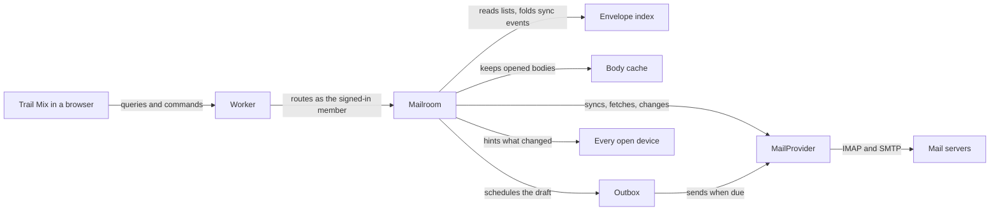

# Trail Mix

Trail Mix is an open-source, keyboard-first mail client that you host yourself. A TanStack Start single-page app, styled with Astryx and StyleX, runs as one Cloudflare Worker. That one deployment serves its operator and the people they invite, and each of them gets a private Mailroom for their own IMAP accounts. It is dense, quiet and fast, and as good on a phone as on a desktop.

This file is the working agreement for everyone who changes this repository, human or agent. A change is reviewed against the rules below. When a change needs a concept, a guarantee or a folder that this file does not name, stop and get this file amended first. Do not invent it in code.

## How it fits together

Every request goes through the Worker to the Mailroom of the signed-in member, and only the Mailroom talks to mail servers.



- **Operator and members.** The operator deploys Trail Mix, pays for it and invites people. A member is anyone invited. Sign-in belongs to Cloudflare Access, which emails a one-time code, so Trail Mix holds no password and has no sign-in code of its own.
- **Worker.** Serves the app, verifies the Cloudflare Access identity on every request, and routes to the Mailroom of that member.
- **Mailroom.** One Durable Object per member, created on first sign-in, with private storage. It is the only writer of anything Trail Mix stores for that member and the only thing that opens a mail connection.
- **Envelope index.** SQLite inside the Mailroom, with a full-text table over senders, recipients, subjects and previews. Lists, conversations and search read it. A search lists conversations newest first by the newest message that matches, and each row shows that message.
- **Body cache.** Raw messages in object storage, keyed by `MessageRef`. A body is fetched from the mail server the first time it is opened and kept after that.
- **Outbox.** A schedule of drafts to send, driven by the Mailroom's alarm. Undo send and send later are the same mechanism, and every send can be undone for ten seconds. It records that the host accepted a message before filing it, so a retry after a failure or a restart only files. A send that fails for a passing reason, such as no connection or an SMTP 4xx, retries after 1, 2, 4, 8, 16 and 32 minutes and then hourly, until its retries have waited a day. A refusal, or a connection lost after the message went out, waits for Retry, and so does a send a restart cut short before its acceptance was recorded, which says it may have gone.
- **MailProvider.** The one contract every mail host is reached through. It has two implementations: IMAP with SMTP, of which Zoho and Outlook are presets, and a seeded demo mailbox that tests, agents, previews and the public demo all use.
- **Browser.** TanStack Query holds snapshots and applies changes optimistically. Each tab holds one WebSocket to its Mailroom.

Three routes cover the whole system:

- **Reading.** Lists come from the index. A body comes from the mail server once and from the cache after that.
- **Sending.** Send schedules a saved draft, and the Outbox submits it when the undo window closes.
- **Staying current.** The Mailroom syncs, folds what changed into the index, and hints every open device to refetch. Inbox is watched live while a device has Trail Mix open and checked every few minutes otherwise. A deploy or an eviction can drop the held connection at any time, so every wake is a cold start: reconnect, sync from the stored cursor, resume watching.

The mail server stays the only authority for mail. Trail Mix owns three things: account settings, encrypted credentials, and the schedule of messages waiting in the Outbox.

### Vocabulary

Every layer uses the same nouns, with the same names in the index, the contracts and the interface. `src/features/mail/core/model.ts` defines them.

| Noun         | Meaning                                                                                                                                |
| ------------ | -------------------------------------------------------------------------------------------------------------------------------------- |
| Account      | One mailbox a member has connected: a name, a stamp color, an optional From name and signature, and a status.                          |
| Folder       | A folder on the mail server, named by a `FolderRef` (account and path), with an optional role, its counts, and its server's delimiter. |
| Folder role  | `inbox`, `sent`, `drafts`, `archive`, `trash` or `junk`. Folders are recognized by role, never by name.                                |
| Message      | What the index holds for one message: its `Envelope` and the conversation it belongs to.                                               |
| `MessageRef` | A message's identity, which is the mail server's own: account, folder path, UIDVALIDITY and UID.                                       |
| Envelope     | What a provider reports about a message: everything a list or a search needs, and no body.                                             |
| Conversation | The messages of one account that reply to each other, gathered from its Inbox, Sent, Archive and Drafts.                               |
| Body         | The content of one message, fetched on first open. It never changes for a `MessageRef`.                                                |
| Draft        | A message in a folder whose role is `drafts`. It lives on the mail server, not in Trail Mix.                                           |
| Outgoing     | An Outbox entry: a draft, when to send it, and how the attempt is going.                                                               |
| View         | What a list shows: one folder, a unified Inbox, Flagged, Drafts or Outbox across every account, or a search.                           |
| Hint         | A message on the WebSocket that names what changed, so the browser knows what to refetch.                                              |
| Stamp        | An account's color. It marks each row in the unified views and the From chip in the composer.                                          |

### Contracts

Every feature is built against three contracts. Change one only together with this file.

- **The mail vocabulary**, in `src/features/mail/core`. It is the one set of types every layer shares.
- **MailProvider**, in `src/features/providers/provider.ts`. Adding a protocol means implementing this interface and nothing else. `sync` reports events (`message`, `flags`, `gone`, `reset`) since a cursor, one bounded batch at a time and newest first, and the index is the fold of those events. A folder starting over begins with a batch of at most 100, so its newest mail shows soon. The fold returns the rows to write, and the Mailroom writes nothing else. The cursor belongs to the provider and is opaque to the Mailroom. `search` asks the server across a whole folder and resolves with envelopes, newest first and at most 100. A full-text result outside the index opens like any other and is never written to the index. `watch` is best effort, so the Mailroom still polls. `deleteFolder` takes the folders inside with it, deepest first, and resolves only once the server no longer lists them.
- **What a browser can ask its Mailroom**, in `src/features/mailroom/client`. Typed server functions carry queries and commands, one WebSocket carries hints, and plain GET routes carry the bytes of messages and remote images. There is no other channel. Queries return snapshots. Commands return once the Mailroom has accepted them. `addAccount` is the only call that carries a secret. Archive and delete are moves to a folder role. A folder is created at its parent's path, delimiter and name, renamed only within its parent, and never renamed or deleted when it, or a folder inside it, has a role. `folders/core/problems.ts` holds the name rules, which the browser checks before it asks and the Mailroom checks again. A folder change shows in the browser at once, laid over the folders until a snapshot shows it, and is lifted with the server's reason if refused.

## Architecture rules

These are invariants. Breaking one needs an amendment to this file, not a clever exception.

- **One authority.** The mail server is the truth for mail. The index and the body cache are disposable: deleting them loses nothing, and they rebuild from the server.
- **The server's identity.** A message is its account, folder path, UIDVALIDITY and UID. Trail Mix mints no message ids of its own.
- **One write path into the index.** Only folded sync events change it. A command changes the mail server, the next sync reports the change, and the fold records it. Browsers show the change optimistically in the meantime.
- **Safe to repeat.** Every write is idempotent. Folding an event again, replaying a sync batch after a cold start, retrying a command and refetching on a duplicate hint change nothing the first time did not, so the recovery from any failure is to try again.
- **A pure core.** Conversation linking, the index fold, IMAP sync reconciliation, quote detection, Markdown-to-mail rendering and the Outbox state machine are pure functions. A `core` module never reaches React, Astryx, StyleX, Cloudflare or a mail library, directly or through another module.
- **Providers per protocol, presets per vendor.** Zoho and Outlook are presets of the one IMAP and SMTP provider: hosts, ports, sign-in method, and quirks such as whether the server files its own copy in Sent. Folder roles come from the server's SPECIAL-USE flags, then imapflow's table of common folder names, and a preset adds hints only for a vendor that needs them.
- **One writer.** Everything for a member runs inside that member's Mailroom. Nothing else opens a mail connection or touches storage.
- **Snapshots and hints.** Queries return snapshots. Hints arrive at most once, in no guaranteed order, and may be lost, so a browser refetches what a hint names and refetches everything on screen after a reconnect. Nothing needs an ordered, replayable stream.
- **Secrets enter once.** A password or refresh token is sent to the server once and encrypted before it is stored, with a key derived for that member from a Worker secret. No query returns it. Outlook sign-in uses the device-code flow, so there is no public callback route.
- **Mail is hostile.** Message HTML is sanitized once in the browser with DOMPurify, with every rewrite done inside its hooks and nothing changed afterwards. It is then rendered in an iframe sandboxed without scripts under a restrictive content security policy. Remote images load only through the Worker's proxy, after the member allows the sender. Every route that returns the bytes of a message or a remote image answers with a sandboxing content security policy and `nosniff`, so opening one directly runs nothing.
- **Never lose a message being written.** A draft is saved before Send schedules it and is removed only after the mail server accepts the send. Exactly one copy lands in Sent. Sending is two provider steps, each safe to repeat, with the Outbox recording the host's acceptance between them: `submit` hands the draft to the host unless Sent already holds its Message-ID, and `file` leaves one copy in Sent, unless the host files its own, then removes the draft. `file` never submits, so nothing after acceptance can deliver twice. A missing draft is never counted as sent.
- **Every request is a member.** The Worker verifies the Cloudflare Access token on each request, and the verified identity alone names the Mailroom. No query, command, socket or file route accepts a member identity from the browser. A command or a socket upgrade from any other origin is refused. Preview and demo deployments use separate storage and can never reach a real account.
- **One member list.** Cloudflare Access holds it. The Members page reads and edits that list for the operator and never keeps a copy.
- **Sign-in is one seam.** Proving who sent a request is a single function that returns a verified email address. Nothing else knows how sign-in works, so it can be replaced without touching the rest. On the local Workers runtime, with no sign-in configured, it names the one development member set in the local `.dev.vars` file, and only for requests addressed to localhost. That is how the dev server, `vite preview` and the smoke suite sign in, and it is inert on Cloudflare.
- **Closed until configured.** A deployment with no sign-in configured answers every request with a setup page. The one exception is the health endpoint, which reports only the running version.
- **The operator is trusted, and members are told.** Whoever controls the Cloudflare account can read everything stored in it, encryption included, because the key is theirs. The README and the first-run screen say so.
- **Storage upgrades itself.** Each Mailroom records its schema version and applies newer versions, in order, when it wakes. Versions are only ever appended, so any deployment can move forward from any earlier release.
- **Idle Mailrooms wind down.** A Mailroom nobody has opened for 30 days stops checking mail, and after 90 days it erases itself.

## Design

### Paper and ink

Trail Mix uses system fonts, dense rows, one `light-dark()` palette, and a recessed backdrop with raised panes. Five ideas make up its identity. Extend them to new screens instead of adding a sixth.

- **A desk and sheets.** The sidebar sits directly on the desk. The conversation list and the reader are sheets lying on it, and inside the reader each message is its own sheet of paper. Light mode is warm paper. Dark mode is a blue-black desk at night, not neutral gray.
- **Ink.** Text is blue-black ink, and the one accent is ink blue: unread marks, links, focus rings, the primary button.
- **The highlighter.** Yellow has exactly one job: marking what the member flagged and what a search matched.
- **Stamps.** Every account has a color, so it is always clear which inbox a message came from and which one a message is about to leave from.
- **Airmail.** A red-and-blue airmail stripe means one thing, that this message is leaving: the undo countdown, Outbox rows, a scheduled send.

Conversation subjects in the reader are set in the system serif. Everything else is system sans, with system monospace for plain-text mail, code and headers. No web fonts load. Selection lifts instead of tinting: the selected conversation rises from the list sheet onto paper.

### Design-system rules

- **Two tools, no third.** Astryx supplies the components and the token vocabulary. StyleX styles everything Trail Mix lays out itself. There is no Tailwind and no second component library. When Astryx lacks a component, build it from Astryx primitives and StyleX. When an Astryx component cannot be bent with its `xstyle` prop or the theme, eject its source with `astryx swizzle` and own it.
- **Tokens, never literals.** Colors come from the Astryx theme in `src/app/theme/trail-mix.ts`, each as a light and dark pair. Every value Astryx has no name for lives in `src/app/theme/tokens.stylex.ts`, except the side panels' widths. Components use neither raw colors nor raw sizes.
- **The virtualized list.** Astryx has none, so the conversation list uses TanStack Virtual, with rows styled in StyleX.
- **StyleX wiring.** The class name prefix is `tm`, so no class collides with the `x` classes Astryx ships precompiled. `useCSSLayers` is on, and lightningcss runs with `Features.LightDark` excluded. In development the HTML loads `/virtual:stylex.css` and `virtual:stylex:runtime`, and every `.stylex.ts` file is transformed before that stylesheet is served, because a `defineConsts` value such as a media query resolves only once its defining file has been. A test compiles the app's styles and fails if any class name also appears in Astryx's stylesheet.
- **Pinned versions.** Every `@astryxdesign/*` and `@stylexjs/*` package is pinned to an exact version, with core and theme on the same version. Upgrade them together, in a pull request that does nothing else and includes before-and-after screenshots of every screen.
- **A single-page app.** No route is rendered on the server. The Worker answers a page request with the document shell alone, rendered when it is requested rather than prerendered at build time, and a small inline script in that shell applies the saved theme mode and pane widths before first paint, so nothing flashes.
- **Theme.** It follows the system by default. A manual Light or Dark choice is saved per device.
- **Width picks the layout, pointer picks the size.** Below 768 pixels there is one pane at a time on a sliding track. On a coarse pointer, at any width, every target is at least 44 pixels.
- **Side panels.** They have pixel widths, resize by drag and by arrow keys, snap to a rail when dragged below their midpoint, keep their widths across a reload, and expose `role="separator"`. Use Astryx's `useResizable` and `ResizeHandle` if they can do all of this. Otherwise the workbench owns a `SidePanel` that does. Their widths are numbers that the side panels own, because the drag and the prepaint script both need them.
- **Accessibility.** All text meets a 4.5:1 contrast ratio in both themes. Each component declares its own reduced-motion and forced-colors behavior. CI checks contrast on every screen of the demo mailbox, light and dark.
- **Motion.** State changes take 125 milliseconds. Panes and the phone track move for 300 milliseconds on the layout easing. Nothing moves under reduced motion.
- **Message content is foreign.** It never inherits Trail Mix's styles. HTML mail renders inside its own sandboxed frame, on paper, and mail that sets its own colors stays on light paper in the dark theme.
- **One command registry.** Every action is a command. The registry feeds the palette, the shortcut sheet and the visible controls, so a shortcut cannot exist without its palette entry.

## Code layout

```text
src/
  app/                 boots the router and the theme
    main.tsx
    router.tsx
    global.css
    root.tsx           the document shell, the one thing the Worker renders
    workbench.tsx      the route that shows the workbench
    prepaint.ts        the inline script that runs before first paint
    theme/
      trail-mix.ts     the Astryx theme
      built/           the theme compiled by `bun run theme`, which the app loads
      tokens.stylex.ts Trail Mix's own tokens
  features/
    mail/core/         the shared vocabulary: model, conversation linking, the index fold, MIME
    providers/         provider.ts is the MailProvider contract
      imap/            the IMAP and SMTP provider and vendor presets, with sync reconciliation in core/
      demo/            the demo provider and its seeded mailbox
    mailroom/
      server/          the Durable Object: schema versions, sync, Outbox, credentials
      client/          queries and commands, and the hint socket
    workbench/ui/      the panes, the side panels and the phone track
    folders/           core/ places folders and names the rules a change must meet, ui/ is the sidebar
    conversations/ui/
    reader/            core/ sanitizes, folds quotes and finds a conversation's folder, ui/ renders the sandboxed frame
    composer/          core/ renders Markdown to mail, ui/ is the editor
    outbox/            core/ is the state machine the Mailroom's alarm drives, ui/ lists what waits
    commands/          registry.ts and the palette
    members/           server/ edits the Cloudflare Access list, ui/ is the Members page
  server/
    entry.ts           the Worker entry
    access.ts          the sign-in seam
    routes/            what is not a server function: hint socket, message bytes, image proxy
  shared/
    build/             build configuration shared with tests, such as the StyleX options
    query-client.ts
tests/
  contract/            the provider contract suite
  e2e/                 the Playwright smoke suite, run by `bun run e2e`
  bench/               one module of budgets per area, measured together by run.ts
  reader/              the hostile-mail corpus and the tests that render it in real browsers
  mail-server/         server.ts starts and stops the native test mail server
  mail-check/          the mail check: check.ts, and worker.ts, the Durable Object it runs in
  workerd.ts           runs a Worker on the local Workers runtime, for the mail check and tests
.github/workflows/     ci.yml and deploy.yml
```

- A feature owns a framework-free `core`, its `server` code and its `ui`. Not every feature needs all three.
- Features reach each other only through an `index.ts`. Inside a feature, modules import each other freely.
- `mail/core` is the shared vocabulary that every other feature imports.
- `src/app` and `src/server` compose features. `src/shared` holds only generic mechanics and knows no feature.
- Imports are relative and carry their file extension. There is no path alias.
- `tests/boundaries.test.ts` walks the import graph and fails on a shortcut between features or on a `core` that reaches a framework.

## Writing Great Code

Great code pursues simplicity by placing a rich domain model at the center, decomposing it into clear responsibilities, and applying functional principles to express its behavior directly. Architecture, state, control flow, boundaries, and tests should follow from real requirements and preserve the product experience with as little machinery as possible.

- Domain coherence
  - Define the smallest coherent ontology of concepts and relationships, then use that vocabulary consistently across every subsystem and layer. These become the system's nouns; scrutinize every addition.
  - Express operations over those values as domain verbs (the subsystem's algebra). A subsystem's public surface should expose capabilities rather than incidental types, wrappers, or implementation steps.
  - Use that model to make valid states, transitions, true dependencies, expected side effects, and ownership explicit. Prefer one source of truth and representations that exclude invalid combinations when practical.
- Semantic decomposition
  - Decompose the domain into subsystems with independently nameable roles, ownership, and contracts. Each subsystem should expose a coherent capability rather than mirror implementation mechanics.
  - Within each subsystem, give every module and component one semantic responsibility. Create or extract one when it gives a capability a clear owner, removes real repetition, or clarifies composition; inline wrappers that only add indirection.
  - Grow the system by extension. Before building a capability, look for an existing one in the owning feature, shared modules and components, sibling features, the installed libraries, and the platform, and extend what fits instead of building a parallel version.
  - Within each file, optimize for linear top-to-bottom reading. Establish its role, domain concepts, and common control flow before supporting mechanics and edge cases; comment only to explain a non-obvious role or invariant.
- Functional architecture
  - Within each boundary, implement domain behavior as a pure, referentially transparent core over immutable values, with explicit inputs, outputs, and transitions.
  - Isolate unavoidable effects, including UI animation, persistence, timers, and external communication, at the owning component or module boundary, with explicit lifetimes and failure behavior.
  - Compose subsystems through narrow contracts. Keep policy and orchestration with their owning layer, and share only genuinely generic mechanics.
- Verifiable contracts
  - Encode domain invariants and policy in executable tests. Verify observable behavior, valid transitions, lifecycle outcomes, and boundary guarantees rather than private implementation details or duplicated logic.
  - Concentrate exhaustive coverage around foundational state machines, reducers, policies, codecs, and boundaries where one defect propagates widely. Test leaf consumers when they own distinct behavior, lifecycle, or integration risk.
  - Keep tests deterministic and readable as specifications: order common behavior before edge cases, prove one contract per test, and introduce narrow seams or protocol-faithful fakes only when needed.

## Engineering

### Toolchain

- **Bun canary 1.4.4 or newer** owns install, format, lint, type-check, test and the production build, which Vite runs. Install it with `bun upgrade --canary`. `bun fmt`, `bun lint` and `bun check` are built in, so there is no Prettier, ESLint or `typescript` package to install.
- **Node 22 or newer** runs two things: `wrangler deploy`, and whatever starts the local Workers runtime, which is the Vite dev server, `vite preview`, and tests that drive a Worker on workerd. Miniflare cannot reach workerd under Bun, because Bun's built-in `undici` ignores the dispatcher it routes requests through. They move back to Bun once oven-sh/bun#39247 is fixed.
- **Scripts name their runtime.** `bun run build` runs `bun --bun vite build`. `bun run dev` and `bun run preview` run Vite's JS entry under `node`. `bunfig.toml` does not set `[run] bun = true`, because that would make `node` inside every script mean Bun.
- **Setup.** `bun install`, copy `.dev.vars.example` to `.dev.vars`, then `bun run dev`.
- **Dependencies are exact versions.** `bun add` pins what it installs, and CI installs from the frozen lockfile. An upgrade is a deliberate edit.
- **One Markdown.** `marked` is pinned to the version `@tiptap/markdown` resolves to, so the composer's editor and the renderer that makes its HTML part read Markdown alike. Upgrade the two together.
- **The Workers runtime's types** are `worker-configuration.d.ts`, which `bun run types` generates from the compatibility date and flags. CI fails when it is stale, so regenerate it with any change to either.
- **Two type programs.** The browser and the Worker run against different globals, so `bun check` runs the `check` script, which checks both. `tsconfig.browser.json` checks the app and its tests against the DOM. `tsconfig.worker.json` checks the Worker, each feature's `server`, the providers and the tests that drive them against `worker-configuration.d.ts`, with no DOM. A module both import, such as `mail/core` or `mailroom/client/contract.ts`, has to check in each, so Worker code reads the client contract from `contract.ts`, not the browser's `client/index.ts`, and the Outbox's state machine from `outbox/core/index.ts`, not `outbox/index.ts`, which carries its views.
- **Lint is strict.** Type-aware rules are on and a warning fails the run. To relax a rule, change `bunfig.toml` or add an `eslint-disable-next-line` comment, and say why in either place.

### Tests

Tests concentrate where a defect spreads.

- Exhaustive `bun test` coverage of the pure core.
- One provider contract suite that runs against the demo provider and against the IMAP provider talking to the test mail server.
- Two other mail clients read what Trail Mix's composer writes, in the built app against the test mail server: Roundcube on PHP's own server, driven in Chromium, and mutt in a pseudo-terminal. CI installs both and sets `MAIL_CLIENTS=required`. On a Mac without `mutt` and `php` their tests skip and say why.
- A Playwright smoke suite that drives the built app on the demo mailbox, at desktop and phone sizes in both themes, and attaches screenshots to the CI run.
- The reader's corpus of hostile and real-world mail renders in Chromium and WebKit under `bun test`, proving that nothing in it runs or loads. A missing browser fails with the command that installs it. `READER_BROWSERS` narrows the run to one of them.
- Tests that need the test mail server or workerd are named `*.mail.test.ts`. `bun test` skips them, and `bun run test:mail` runs them. Run it before pushing a change to mail I/O.
- The Mailroom's own tests run it on workerd through `mailroom/server/test-worker.ts`, which names the member by the request's path in place of sign-in, and adds what a test needs to look inside. Nothing in the production Worker serves it.
- A test earns its place by catching a defect someone can name. Tests that restate the implementation, check constants or defaults, or mock Trail Mix's own modules are removed in review. Fakes stand in only for things outside Trail Mix.

### Performance budgets

`bun run bench` measures each budget on the built app, fails when one is exceeded, and runs locally and in CI, which attaches the numbers. It and `bun run e2e` need a build, so they stay out of `bun test`. Each e2e suite takes the built app and its browser from `tests/e2e/suite.ts`, which starts either again when a test that timed out took it down, since Bun then ends every process the file started (oven-sh/bun#46373). Budgets are measured against a demo mailbox that scales deterministically to 50,000 messages, and the browser ones use a phone profile of four times CPU slowdown on the reference desktop. Each run measures its machine with Lighthouse's CPU benchmark index and scales the slowdown to match, so a slower machine, such as a CI runner, emulates the same phone rather than a slower one. `tests/bench/phone.ts` holds that profile, and the bench prints the index and the slowdown it chose above the budgets. `bun run bench <area>` measures one area, as CI does in the job that has what that area needs. The Mailroom's area syncs from the test mail server, whose `bench` user holds the demo's Personal Inbox at 50,000 messages, kept between runs, and it counts a batch's CPU as what workerd spends between the hints for two batches. Every Worker a test or a bench starts runs without Wrangler's local explorer and its trace collector, which a deployed Worker doesn't have and which would otherwise spend about as much CPU on the Worker's thread as the Mailroom does. Two build plugins in `src/shared/build` keep Astryx's share of the first load to what the bundled components use: `astryxMessages` swaps `intl-messageformat` for a formatter of `{name}` and `{name, number}`, and fails the build if a bundled component's English needs more, and `astryxIcons` keeps only the theme icons in `THEME_ICON_NAMES` and drops Astryx's fallback set, failing the build if bundled Astryx code names an icon it would prune. Both are ported from Pixels, and anything only a later screen needs, such as menus, toasts and dialogs, loads lazily.

| What                                                      | Budget                                                          |
| --------------------------------------------------------- | --------------------------------------------------------------- |
| Cold load to the first Inbox rows                         | 1 second, with at most 250 KB of JS, gzip                       |
| Scrolling a 50,000-message folder                         | 60 frames a second                                              |
| Moving through the list by key, or archiving              | 50 milliseconds                                                 |
| A page of the unified Inbox, or a 50-message conversation | 10 milliseconds in the Mailroom                                 |
| Search as you type                                        | 100 milliseconds                                                |
| First sync of a 50,000-message folder                     | 2 minutes, with no batch over 1 second of CPU                   |
| Moving to a conversation with 300 KB of HTML              | 200 milliseconds to render, its body sanitized ahead while idle |
| Worker startup                                            | Checked by `wrangler check startup` in CI                       |

### Mail safety

- Never touch anyone's real mail. Development, tests and previews use the demo provider and the test mail server. Only an operator connects real accounts.
- One Worker variable, `DEMO_MAILBOX`, gives every new Mailroom the demo's two accounts, Personal with that many messages in its Inbox and Work with a tenth as many. Development, the smoke suite and the benchmarks start that way. A second, `DEMO_MAILBOX_AT`, fixes the accounts' creation time, so the smoke suite's screenshots and the benchmarks see the same dates on every run. Without it, an account is created when the Mailroom adds it. It is an ISO 8601 instant with its offset, and a Mailroom refuses to start with anything else. Its mail server turns away the first try of each message to anyone at `unreachable.example`, as a Personal draft is, so a demo shows a refused send and its Retry. It turns away the first delete of the seeded `Projects` with RFC 5530's `[INUSE]`, so a demo shows a refused delete too. The demo provider is a mail server held as one value, a base mailbox computed from each message's number and the account's creation time plus the member's changes. The Mailroom stores it apart from the index and the body cache, so erasing those rebuilds the same lists.
- The test mail server runs natively, with no Docker or other container. One Bun script starts and stops it, on a laptop and in CI alike: `bun run mail-server start`, with `--profile zoho` or `--profile outlook` to withhold what those hosts lack, or `--profile plain` for a server with IDLE and no other extension. Dovecot 2.4 serves IMAP. A Bun process serves submission on implicit TLS and STARTTLS, delivers only to `trailmix.test`, and stands in for Microsoft's sign-in. On the `outlook` profile it files its own copy of what it accepts in Sent a moment later, as Outlook does, and the demo provider can play that host too. A test can pause a user's sending, which submission then refuses with a 554, as a host does for an account over its limit. Everything binds to loopback, on ports 3000 above the standard ones, or above `MAIL_SERVER_PORTS` when a second checkout needs its own server.
- On a Mac, the script builds Dovecot 2.4.5 with the upstream fix for TLS logins once, into `.mail-server/`, until Homebrew has 2.4.6. It needs Xcode's command line tools and `brew install openssl@4 pkgconf`. On Ubuntu, Dovecot comes from repo.dovecot.org, as CI installs it.
- The mail check, `bun run mail-check`, is how an operator tests a real account. A password comes from a prompt with echo off or from a pipe, never from an argument or environment variable, and nothing writes it to disk or prints it. Outlook signs in with Microsoft's device-code flow.

### A public repository

- The repository holds no secret, account name, personal address or local path. Secrets live in Worker secrets and GitHub secrets.
- `CREDENTIALS_KEY` is the Worker secret each member's credentials key is derived from, at least 32 characters. The one in `.dev.vars.example` is for development only.
- Workflows that deploy run only where the Cloudflare secrets exist, so forks and outside pull requests build and test but never deploy.

### Pipeline

- **CI** runs on every pull request and every push to main: install from the frozen lockfile, format check, lint, type-check, test and build, then a check under Node that the built Worker deploys (`wrangler deploy --dry-run`) and starts within Cloudflare's limit (`wrangler check startup`), then the Playwright smoke suite against the built app. A second job installs Dovecot and runs `bun run test:mail`, which includes the provider contract suite against the test mail server, then `bun run bench mailroom`. The main job runs the reader's browser tests in Chromium, and a third job on `ubuntu-24.04` runs them in WebKit, the engine of every iPhone browser, whose system libraries install quickly only there. That job keeps those libraries' packages for each runner image and Playwright version, so it reaches apt's mirror only when one of them changes.
- **Preview** runs on every pull request, after CI. It deploys the branch to an isolated environment with its own storage that enables only the demo provider, and posts the address on the pull request.
- **Production** runs on every push to main, after CI. It deploys with the commit as its version and then calls the health endpoint. If the endpoint does not report that commit, the workflow rolls back and fails.
- **Demo** runs after production. It deploys the public demo: no sign-in, demo provider only, one Mailroom per visitor that erases itself after a day.

## Definition of done

- `bun fmt --check`, `bun lint`, `bun check`, `bun test` and `bun run build` all pass locally before a push, and CI is green on main afterwards.
- Work lands directly on main, one coherent step at a time, and never leaves main undeployable. Open a pull request, which gets a preview, for a change that wants a look before it lands.
- The change keeps every rule in this file, or amends this file in the same change.

## Not in scope

Adding any of these is a decision for the maintainer, not something a change drifts into.

- Snooze, reminders when nobody replies, saved searches as split inboxes, and snippets.
- AI triage, summaries and drafted replies.
- A Microsoft Graph or Zoho REST provider, and POP3.
- Presets beyond Zoho and Outlook. Any IMAP server already works by entering its hosts.
- Calendar invitations, contacts sync and sender screening.
- Writing or queuing mail while offline.
- Roles beyond operator and member, limits per member, and a sign-in of Trail Mix's own.
- Sharing between members: shared mailboxes, delegation or a common address book.
- Versioned releases, a changelog, and update notices for operators.
- Server rendering of pages, and a floating composer that can be minimized.
